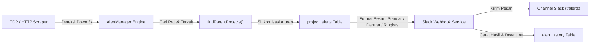

# OBSERVEPULSE — Enterprise Service Monitoring Dashboard

A production-grade, highly performant microservice & infrastructure observability dashboard built with **React 18**, **TypeScript**, **Vite**, **Tailwind CSS**, **React Router v6**, **TanStack Query v5**, and **Recharts**.

> 📖 **Dokumentasi Lengkap Fitur Sistem (Bahasa Indonesia):**  
> Baca panduan komprehensif seluruh modul, APM, stress test k6, Attention Center, serta AI Agent Prompt Generator di [DOKUMENTASI_FITUR_SISTEM.md](DOKUMENTASI_FITUR_SISTEM.md).

---

## 🚀 Key Features

- 🤖 **AI-Driven SRE & External Agent Prompt Generator**: Real-time root cause analysis (RCA), CLI remediation commands, and 1-click structured prompt generator for external AI agents (Cursor, Antigravity IDE, Claude Code, ChatGPT).
- 🚨 **Attention Center & Proactive Anomaly Detection**: Automatic detection of storage saturation, CPU spikes, container crash-loops, and degraded projects.
- 🔔 **Multi-Project Slack Alerting & Incident Notification Engine**: Real-time Slack incoming webhooks integration per project with 3 message styles (⚡ Standar, 🚨 Darurat S1, 💬 Ringkas), emergency mentions (`@here`, `@channel`), team custom notes, auto-recovery with MTTR downtime tracking, and persistent audit logging in `alert_history`.
- 📁 **Multi-Tenant Project Hierarchy & Unified Wizard**: Dynamic project-level filtering backed by database synchronization with a sequential 3-step modal (`[1] Identitas` → `[2] Alokasi Server Host` → `[3] Notifikasi Slack & Live Preview`) supporting full create and edit modes.
- 🧪 **Built-in Grafana k6 Stress & Load Testing Simulator**: Dual mode (Load vs Stress), dynamic 1 VU = 1 real user JWT generation, anti-mocking telemetry, visual flow builder with context injection, and Gemini AI test analysis.

- 📊 **Executive Overview Dashboard**: High-level Golden Signals (Throughput, 1,850 Errors, Avg Latency, Uptime SLA), multi-series latency trends, service health distribution, and microservices status catalog.
- 🖥️ **Infrastructure Server Monitoring**: Node-level metrics (CPU, RAM, Disk IOPS, Network MB/s), process counts, and hosted container workloads.
- ⚡ **Microservice Deep-Dive (7 Scoped Sub-tabs per Service)**:
  1. **Overview**: Service Golden Signals, live dependency topology graph, and top exception breakdowns.
  2. **Requests Explorer**: Real-time request log with HTTP status, duration, and full Waterfall APM trace inspector modal.
  3. **Errors Tracking**: Exception stack trace inspector with breadcrumb timeline and occurrence frequency.
  4. **Latency & APM**: p50, p90, p95, p99 percentiles timeline and response time distribution histogram.
  5. **Logs Stream**: Live terminal log viewer with level filtering (ERROR/WARN/INFO/DEBUG), structured metadata inspector, regex search, and auto-scroll.
  6. **Dependencies**: Visual upstream & downstream topology graph with node click drill-down.
  7. **Alerts**: Real-time alert manager with Acknowledge and 1-hour Silence actions.
- 🔄 **Dynamic Global Controls**: Global Environment selector (`production`, `staging`, `development`), Server filter, Service filter, Time-Range Presets (`15m`, `1h`, `6h`, `24h`, `7d`), and configurable Auto-Refresh interval (Off, 5s, 10s, 30s, 60s).
- 🌓 **Dark & Light Mode Support**: Seamless theme switching with localStorage persistence.
- 🔌 **Pluggable Architecture (`IMonitoringProvider`)**: Zero component lock-in. Switch between `MockMonitoringProvider`, `PrometheusMonitoringProvider`, and `LokiLogProvider` via clean dependency injection.

---

## 🔔 Multi-Project Slack Alerting & Audit Logging System

Sistem notifikasi insiden real-time berbasis **Slack Incoming Webhook** yang terintegrasi penuh dengan siklus pemantauan backend dan tabel audit database PostgreSQL / MySQL.



### 🌟 Fitur Utama Sistem Notifikasi & Alert:
1. **Multi-Project Routing Cerdas**:
   - Ketika server atau microservice terputus, sistem secara otomatis mencari **seluruh projek** yang menaungi target tersebut dan mengirimkan notifikasi ke semua webhook Slack aktif yang terdaftar (tidak lagi terhalang oleh projek yang belum memasang webhook).
2. **3 Gaya Pesan (*Message Style Presets*)**:
   - ⚡ **Standar (*STANDARD*)**: Kartu Slack Block Kit informatif memuat detail projek, nama target, alamat IP/host, diagnosa error, dan waktu kejadian (WIB).
   - 🚨 **Darurat S1 (*EMERGENCY*)**: Banner beraksen merah `[DARURAT S1] OUTAGE PADA TARGET!`, memicu panggilan darurat prioritas tinggi untuk tim SRE/On-Call.
   - 💬 **Ringkas (*COMPACT*)**: Format satu baris ringkas yang hemat ruang untuk channel obrolan tim yang aktif.
3. **Instruksi & Catatan Tim Khusus (*Team Note*)**:
   - Anda dapat menyematkan catatan SOP penanganan insiden langsung ke dalam pesan notifikasi di Slack (misal: `"Segera hubungi PIC On-Call atau lakukan restart container"`).
4. **Notifikasi Pemulihan Otomatis (*Auto-Recovery*)**:
   - Saat target pulih (*up kembali*), sistem secara otomatis menghitung durasi gangguan (*Mean Time to Recovery / MTTR*) dan mengirimkan notifikasi pemulihan hijau bertuliskan total downtime (contoh: `"Total Downtime: 4 Menit 12 Detik"`).
5. **Anti-Flapping & Anti-Spam Throttling**:
   - Mencegah *spam alert* dengan ambang batas minimal 3 kali kegagalan berturut-turut (`CONSECUTIVE_FAILURES_THRESHOLD = 3`) dan interval *cooldown* 30 menit pada insiden yang sedang aktif.
6. **Alat Uji Langsung (*Live Testing Tools*)**:
   - Tombol **`⚡ Tes Webhook`**: Mengirimkan ping verifikasi koneksi ke channel Slack saat mendaftar atau mengedit projek.
   - Tombol **`⚡ Uji Kirim Alert Darurat`**: Memicu simulasi pengiriman pesan insiden darurat langsung ke Slack dari tab *Notifikasi & Alert* pada detail projek.

### 🗄️ Skema Database Relasional:

#### 1. Tabel Aturan Notifikasi (`project_alerts`)
Menyimpan aturan notifikasi terisolasi per projek:
```sql
CREATE TABLE IF NOT EXISTS project_alerts (
  id VARCHAR(64) PRIMARY KEY,
  project_id VARCHAR(64) NOT NULL REFERENCES projects(id) ON DELETE CASCADE,
  name VARCHAR(255) NOT NULL,
  webhook_url TEXT NOT NULL,
  channel_label VARCHAR(100) DEFAULT '#monitoring-alerts',
  mentions VARCHAR(64) DEFAULT '',
  triggers_json JSONB DEFAULT '{"serverDown": true, "serviceDown": true, "onRecovery": true}',
  message_style VARCHAR(32) DEFAULT 'STANDARD',       -- STANDARD | EMERGENCY | COMPACT
  team_note TEXT DEFAULT '',                         -- Catatan/Instruksi Tim Khusus
  use_custom_template BOOLEAN DEFAULT FALSE,
  custom_template TEXT DEFAULT '',
  is_enabled BOOLEAN DEFAULT TRUE,
  created_at TIMESTAMPTZ NOT NULL DEFAULT NOW(),
  updated_at TIMESTAMPTZ NOT NULL DEFAULT NOW()
);
CREATE INDEX idx_project_alerts_project ON project_alerts (project_id);
```

#### 2. Tabel Audit Log Riwayat Pengiriman (`alert_history`)
Mencatat seluruh rekam jejak pengiriman notifikasi Slack (baik yang berhasil maupun yang gagal):
```sql
CREATE TABLE IF NOT EXISTS alert_history (
  id BIGSERIAL PRIMARY KEY,
  project_id VARCHAR(64),
  project_name VARCHAR(255),
  alert_id VARCHAR(64),
  target_type VARCHAR(32) NOT NULL,      -- SERVER | SERVICE
  target_name VARCHAR(255) NOT NULL,
  target_host VARCHAR(255),
  severity VARCHAR(32) NOT NULL,         -- CRITICAL | WARNING | RESOLVED
  event_type VARCHAR(32) NOT NULL,       -- DOWN | RECOVERY
  error_message TEXT,
  duration_sec INT DEFAULT 0,            -- Total downtime (MTTR) saat pulih
  channel_label VARCHAR(100),
  status VARCHAR(32) DEFAULT 'SENT',     -- SENT | FAILED
  dispatch_error TEXT,
  sent_at TIMESTAMPTZ NOT NULL DEFAULT NOW()
);
CREATE INDEX idx_alert_history_project ON alert_history (project_id, sent_at DESC);
```

---

## 📑 Modal Terpadu Tambah & Edit Projek (`QuickCreateProjectModal`)

Formulir pembuatan dan pengeditan projek telah disatukan dalam satu komponen serbaguna dengan layout UX 3 langkah berurutan:
1. **`[1] Identitas & Lingkungan Projek`**: Pengaturan nama projek, deskripsi, dan environment (`PRODUCTION`, `STAGING`, `DEVELOPMENT`).
2. **`[2] Alokasi Server Host ke Projek`**: Checklist alokasi server host yang tergabung dalam projek.
3. **`[3] Notifikasi Slack & Pesan Alert`**:
   - Pilihan integrasi Slack atau tanpa notifikasi.
   - Kolom Webhook URL dan tombol **`⚡ Tes Webhook`**.
   - Target channel label (`#alerts`).
   - Pilihan gaya pesan (⚡ Standar, 🚨 Darurat S1, 💬 Ringkas).
   - Panggilan darurat / mentions (`@here`, `@channel`, atau tanpa mention).
   - Catatan tambahan untuk tim.
   - **Visual Live Message Preview**: Menampilkan pratinjau tampilan pesan secara langsung sebelum disimpan.

---

---

## 📁 Directory Architecture

```text
src/
├── components/
│   ├── charts/         # LineChart, BarChart, DonutChart (Recharts)
│   ├── common/         # MetricCard, StatusBadge, SeverityBadge, Modal, Skeletons, EmptyState
│   ├── filters/        # GlobalFilter, TimeRangePicker, AutoRefreshControl
│   ├── monitoring/     # LogViewer, DependencyGraph, RequestDetail, ErrorDetail
│   ├── navigation/     # Sidebar, Topbar, Breadcrumbs
│   └── tables/         # DataTable (sortable, searchable, paginated), AlertTable
├── context/            # FilterContext, ThemeContext
├── hooks/              # Custom TanStack Query data-fetching hooks
├── layouts/            # DashboardLayout
├── mock/               # Single-source-of-truth relational mock database
├── pages/
│   ├── OverviewPage.tsx
│   ├── servers/        # ServerListPage, ServerDetailPage
│   └── services/       # ServiceListPage, ServiceDetailPage & 7 Sub-tabs
├── routes/             # React Router v6 configuration
├── services/           # IMonitoringProvider, MockProvider, Prometheus/Loki stubs, monitoringApi
├── types/              # Full TypeScript domain interfaces
└── utils/              # Formatters, Date helpers, Status color mappings
```

---

## 🛠️ Getting Started

### Local Development

1. **Install Dependencies**:
   ```sh
   npm install
   ```

2. **Run Development Server**:
   ```sh
   npm run dev
   ```
   Open [http://localhost:5173](http://localhost:5173) in your browser.

3. **Build for Production**:
   ```sh
   npm run build
   ```

4. **Preview Production Build**:
   ```sh
   npm run preview
   ```

---

## 🐳 Docker Deployment

The project provides a full-stack containerized architecture with **Nginx Reverse Proxy**, **React Frontend**, **Node.js Monitoring Backend**, and **Persistent Volume Storage**.

### Architecture Overview
- **Single Port Entry (`80` / `8080`)**: All requests to `/`, `/api/*`, and `/socket.io/*` are handled seamlessly through the Nginx gateway without CORS issues.
- **Data Persistence**: Discovered servers and dynamic service registries are preserved across restarts inside the `dashboard_monitoring_data` volume.

### Quickstart with Docker Compose

1. **Start Complete Stack**:
   ```sh
   docker compose up -d --build
   ```
   Open [http://localhost](http://localhost) (or [http://localhost:8080](http://localhost:8080)) in your browser.

2. **Check Logs**:
   ```sh
   docker compose logs -f
   ```

3. **Stop Containers**:
   ```sh
   docker compose down
   ```

### Multi-Environment Deployment (CI/CD / Jenkins)

- **Development**:
  ```sh
  docker compose -f docker-compose.dev.yml up -d --build
  ```
- **Production**:
  ```sh
  docker compose -f docker-compose.prod.yml up -d --build
  ```

---

## 🔄 CI/CD Jenkins Pipeline

The included `Jenkinsfile` provides automated validation and deployment:
1. SCM Checkout
2. Terraform validation & workspace planning
3. Development stack deployment
4. Interactive approval gate for production
5. Automated production deployment via Docker Compose